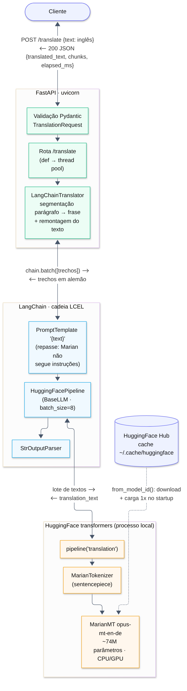
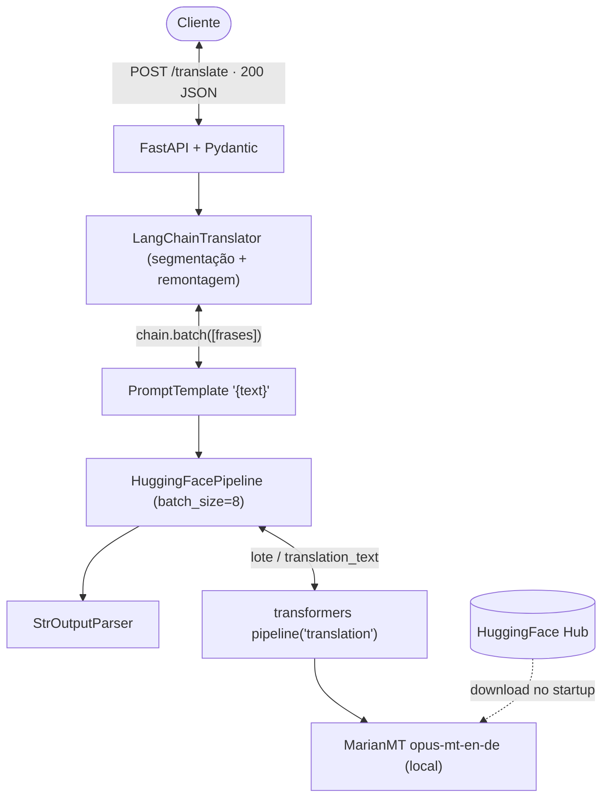

# Parte 2 · Questão 3 — Tradução EN → DE com LangChain + HuggingFace (FastAPI)

API em **FastAPI** que traduz inglês → alemão com o modelo **Helsinki-NLP/opus-mt-en-de**, com as
chamadas ao modelo gerenciadas pelo **LangChain** (`HuggingFacePipeline` em uma cadeia LCEL).

## Arquitetura



<details><summary>Código Mermaid do diagrama</summary>


</details>

### Interações entre os componentes

| Etapa | Componente | O que acontece |
|---|---|---|
| 1 | **FastAPI** | Valida `{"text"}` (Pydantic), injeta o tradutor (`Depends`), executa a rota em *thread pool*. |
| 2 | `LangChainTranslator` | Divide o texto em parágrafos → frases (limite de 512 tokens do modelo e melhor qualidade). |
| 3 | **LangChain** `chain.batch()` | Aplica `PromptTemplate → HuggingFacePipeline → StrOutputParser` a todas as frases. |
| 4 | `HuggingFacePipeline` | Adapta o pipeline do HF à interface `BaseLLM` do LangChain e envia lotes de 8 frases. |
| 5 | **HuggingFace** `transformers` | Tokeniza (SentencePiece), roda o MarianMT localmente e devolve `translation_text`. |
| 6 | FastAPI | Remonta os parágrafos e responde JSON com `translated_text`, `chunks` e `elapsed_ms`. |

O modelo é baixado do **HuggingFace Hub** uma única vez (`HuggingFacePipeline.from_model_id`, no
`lifespan`) e fica em cache em `~/.cache/huggingface`. Toda a inferência é local, sem custo por chamada.

**Observação:** modelos MarianMT **não seguem instruções**. Qualquer texto extra no prompt seria
traduzido junto, por isso o template é apenas `"{text}"`.

## Estrutura

```
app/
├── main.py           # FastAPI: lifespan (carrega modelo/cadeia), /translate, /health
├── chain.py          # HuggingFacePipeline.from_model_id + cadeia LCEL
├── translator.py     # LangChainTranslator: segmentação, chain.batch, remontagem
├── text_chunking.py  # segmentação parágrafo → frase
├── schemas.py        # modelos Pydantic
└── config.py         # APP_HF_MODEL, APP_DEVICE, APP_MAX_CHUNK_TOKENS, APP_BATCH_SIZE
tests/                # cadeia com FakeListLLM, segmentação, API e integração com o modelo real
```

## Como executar

Pré‑requisito: Python 3.10+. O modelo (~300 MB) é baixado na primeira execução.

```bash
python -m venv .venv
```

```bash
source .venv/bin/activate        # Windows: .venv\Scripts\activate
```

```bash
pip install torch --index-url https://download.pytorch.org/whl/cpu   # opcional: PyTorch só CPU
```

```bash
pip install -r requirements.txt
```

```bash
uvicorn app.main:app --reload
```

Swagger: http://127.0.0.1:8000/docs

### Exemplos (respostas reais, CPU 4 núcleos)

```bash
curl -X POST http://127.0.0.1:8000/translate -H "Content-Type: application/json" -d '{"text": "Hello! How are you today?"}'
```

```json
{"source_language":"en","target_language":"de","original_text":"Hello! How are you today?","translated_text":"Guten Tag! Wie geht's dir heute?","model":"Helsinki-NLP/opus-mt-en-de","chunks":2,"elapsed_ms":233.83}
```

Texto com dois parágrafos:

```json
{
  "translated_text": "Künstliche Intelligenz transformiert die Art und Weise, wie Unternehmen Software bauen. Entwickler verwenden jetzt Sprachmodelle, um Code zu schreiben.\n\nAllerdings machen diese Werkzeuge immer noch Fehler, so dass menschliche Überprüfung nach wie vor unerlässlich ist.",
  "model": "Helsinki-NLP/opus-mt-en-de",
  "chunks": 3,
  "elapsed_ms": 721.88
}
```

### Testes

```bash
pytest -q
```

```bash
RUN_INTEGRATION=1 pytest -q     # inclui tradução real (curta e longa)
```

## Referências

- Model card: https://huggingface.co/Helsinki-NLP/opus-mt-en-de (licença CC‑BY‑4.0)
- LangChain HuggingFacePipeline: https://python.langchain.com/docs/integrations/llms/huggingface_pipelines/
- Uso de IA: desenvolvido com apoio do assistente Claude (Anthropic) como ferramenta de apoio; o código foi revisado, testado e é compreendido pelo autor.
